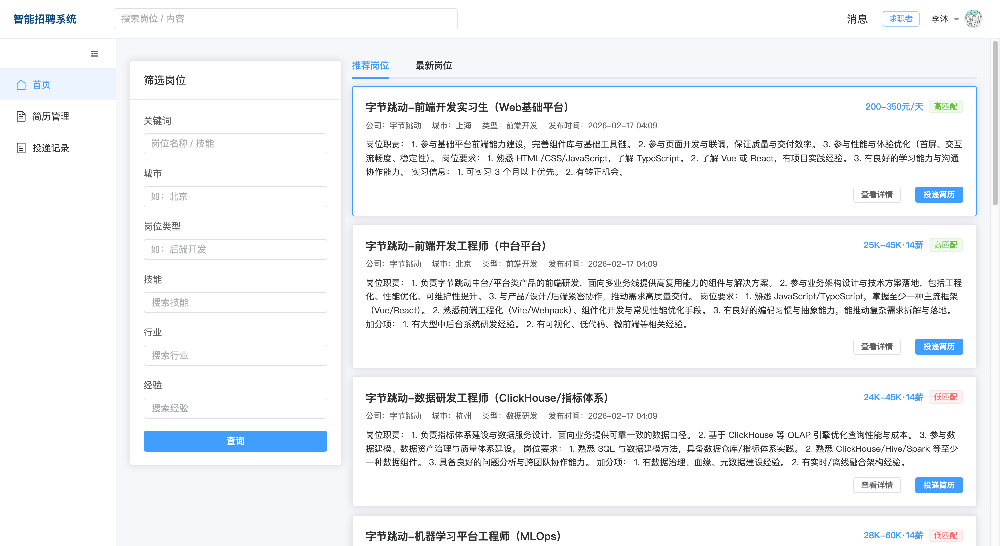
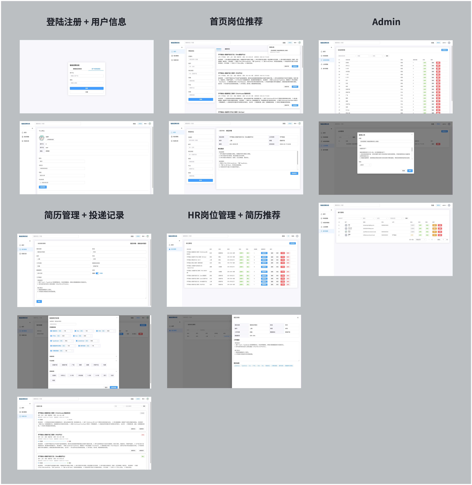

# Lan-Recruitment（毕业设计-智能招聘系统）

> 本分支为“毕业生就业推荐与岗位匹配系统”本机演示交付，**待统一审核**。
> 启动、演示、迁移、实验和限制见 [交付报告](docs/DELIVERY_REPORT.md)；
> 原项目与依赖来源见 [第三方声明](THIRD_PARTY_NOTICES.md)。
> 本机演示使用隔离的合成数据库，并依次执行 V001 至 V004。
> 可生成中文虚构岗位、学生和投递：[演示数据导入说明](docs/DEMO_DATA.md)。
> M0 历史证据见 [M0 报告](docs/M0_REPORT.md) 与 [基线说明](docs/BASELINE.md)。
> 以下保留上游 README；其示例默认库、默认账号与跳过测试命令不作为本次 demo 启动路线。

> 系统首页



> 功能演示



## 项目结构

本仓库为 Monorepo 结构：

- `/backend`：后端（Java 8 + Spring Boot + MyBatis-Plus + Sa-Token + MySQL）
- `/frontend`：前端（Vue 3 + Vite + Element Plus + Axios）
- `/scripts`：一键启动脚本
- `/docs`：需求与规范文档

## 上游历史说明（以下内容不描述 M2 当前算法）

### 上游推荐与匹配算法

系统内的“岗位推荐 / 简历筛选排序”基于标签向量相似度：将简历/岗位标签映射为稀疏向量 `{tagId -> weight}`，用余弦相似度计算匹配分（保留 4 位小数），并按分数从高到低排序；当用户无可用简历时退化为随机推荐。

为减少重复计算，匹配分采用二级缓存：先读内存/Redis 缓存，未命中再读数据库表 `match_score`，两者都未命中才重新计算；当简历标签或岗位标签变化时会清理相关缓存与 `match_score`，确保下一次请求重新匹配。

核心实现：`backend/src/main/java/com/lanrecruitment/service/impl/MatchServiceImpl.java`

## 后端启动

1. 执行数据库初始化 SQL ：`/backend/sql/init.sql`

2. 配置 `/backend/src/main/resources/application-dev.yml` ：

```yaml
spring:
  datasource:
    url: jdbc:mysql://localhost:3306/lan_recruitment?useUnicode=true&characterEncoding=utf8&useSSL=false&serverTimezone=Asia/Shanghai
    username: root
    password: 123456 # 修改为你的密码
    driver-class-name: com.mysql.cj.jdbc.Driver
  # 如果 lan.sa-token.store=redis，需要配置 Redis 连接
  redis:
    host: localhost
    port: 6379
    password: 123456
    database: 0

lan:
  # Sa-Token 登录态存储方式：memory（默认）/ redis
  sa-token:
    store: redis
  # 匹配分缓存：memory（默认）/ redis
  match:
    cache:
      store: redis
  # 配置邮箱服务
  email:
    host: # 你的 SMTP 服务器地址
    from: # 你的发件人邮箱地址
    password: # 你的邮箱服务商 SMTP 授权码
    username: # 你的 SMTP 服务器认证账号
```

3. 执行启动命令：

```bash
cd backend

mvn -q -DskipTests spring-boot:run
```

4. 健康检查：GET http://localhost:8080/api/health

## 前端启动

1. 配置后端请求地址 `/frontend/.env` ：

```bash
VITE_API_BASE_URL=http://localhost:8080
```

2. 执行启动命令：

```bash
cd frontend

npm i

npm run dev
```

## 一键启动（推荐）

配置好前后端环境后，在项目根目录执行：

- macOS / Linux：

```bash
bash scripts/dev.sh
```

- Windows（PowerShell）：

```powershell
powershell -NoProfile -ExecutionPolicy Bypass -File .\scripts\dev.ps1
```

- Windows（cmd）：

```bat
scripts\dev.cmd
```

## 内置账号

> 执行 backend/sql/seed_demo_data.sql 生成内置帐号

- 管理员：admin / 123456
- 求职者：user / 123456
- HR：hr / 123456
