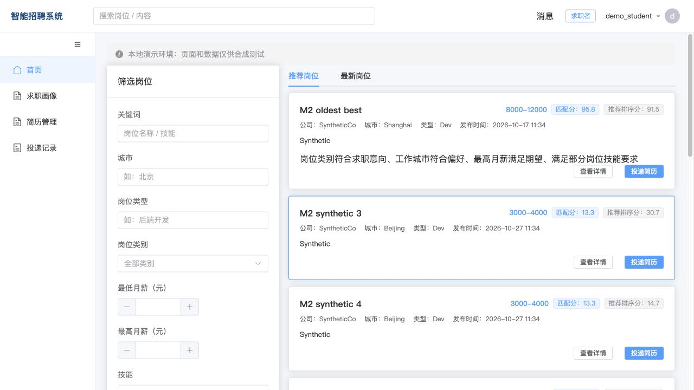
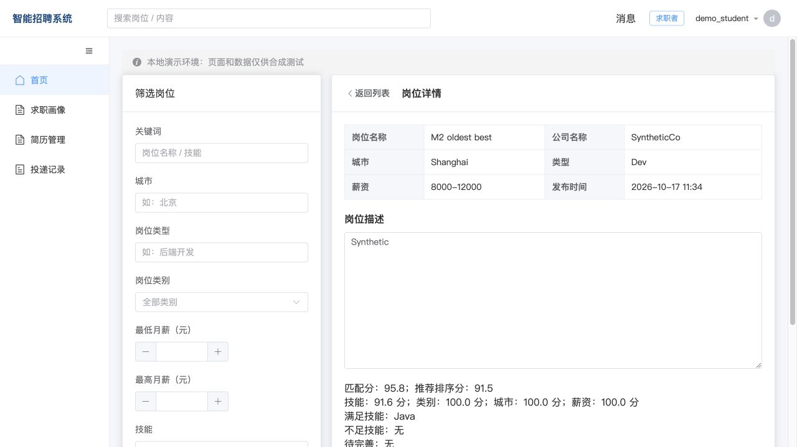
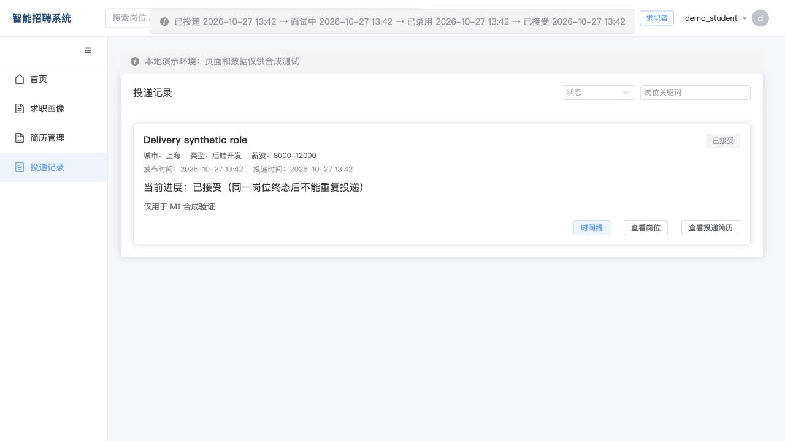

# 毕业生就业推荐与岗位匹配系统

基于 **Spring Boot + Vue 3** 的毕业生就业推荐与招聘管理系统，覆盖学生求职、企业招聘、平台审核三个角色，支持可解释推荐、简历投递快照和面试录用流程。

本项目在 [Lan-Recruitment](https://github.com/lanseqingling/lan-recruitment) 基础上改造，面向毕业设计、教学实践和本地演示。保留上游 MIT 许可与版权，改造范围见 [第三方来源说明](THIRD_PARTY_NOTICES.md)。

[功能介绍](#功能介绍) · [页面预览](#页面预览) · [安装运行](#安装运行) · [演示数据](#演示数据) · [项目文档](#项目文档)

## 功能介绍

| 角色 | 主要功能 |
| --- | --- |
| 学生 | 求职画像、在线简历与附件、技能熟练度、岗位筛选、个性化推荐与解释、收藏与隐藏、投递记录、接受或婉拒录用 |
| 企业 | 岗位发布与维护、审核申请、查看本企业投递及简历快照、面试邀请、拒绝与录用、招聘状态时间线 |
| 管理员 | 企业与岗位审核、账号管理、标签管理、公告管理、基础统计、管理操作审计 |

### 推荐与匹配

- **资格筛选**：结合审核状态、在招状态、有效期、学历及毕业要求筛选候选岗位，处理已投递和隐藏记录。
- **内容匹配**：从技能、岗位类别、城市、薪资四个维度计算匹配结果，展示分项得分、满足的技能和技能差距。
- **混合推荐**：融合内容匹配、基于用户行为的协同过滤与岗位热度；行为不足时回退到内容与热度，资料不足时使用热度推荐。
- **批次加载**：保存推荐批次，稳定加载后续结果；相关资料或岗位变化后重新计算。

匹配分与推荐排序分用途不同，均由后端计算。推荐提供选择参考，不自动作出录用决定。

### 投递与招聘流程

企业发布岗位 → 管理员审核 → 学生浏览或获取推荐 → 学生投递 → 企业查看与面试 → 企业录用 → 学生接受或婉拒。

同一学生对同一岗位只能保留一条投递记录。投递时保存画像、简历、岗位、匹配及附件快照，之后修改当前资料不会覆盖历史快照；状态变更保存时间线，并校验操作者权限和记录版本。

## 页面预览

以下为开发阶段的真实页面截图，使用合成数据；示例内容不代表真实招聘信息。

### 岗位推荐



<details>
<summary>查看匹配解释与投递流程</summary>

**匹配解释**



**投递状态**



</details>

## 技术栈

| 层次 | 技术 |
| --- | --- |
| 前端 | Vue 3、Vite 5、Vue Router、Element Plus、Axios |
| 后端 | Java 8、Spring Boot 2.7.18、MyBatis-Plus 3.5.6 |
| 认证 | Sa-Token 1.38.0、BCrypt 密码哈希 |
| 数据 | MySQL、数据库迁移脚本、本地附件存储 |
| 构建与实验 | Maven、npm、Python、Java 推荐评估程序 |

前端通过 HTTP 接口访问后端。后端按 Controller → Service → Mapper 分层，统一处理认证、业务校验、推荐计算和数据访问。本地演示使用内存登录态与缓存，核心流程不需要 Redis、真实邮件服务或模型 API。

## 项目结构

```text
graduate-job-match/
├── backend/               # Spring Boot 后端
│   ├── src/main/          # 业务代码与配置
│   ├── src/test/          # 后端测试
│   └── sql/               # 初始化及增量迁移
├── frontend/              # Vue 页面、路由和接口封装
├── docs/                  # 需求、接口、迁移、运行及验证文档
├── scripts/               # 本地运行、数据生成及验证工具
├── evaluation/            # 推荐实验方法与结果
├── LICENSE
└── THIRD_PARTY_NOTICES.md
```

## 安装运行

### 1. 准备环境

- JDK 8、Maven 3.9.x。
- Node.js 与 npm；前端依赖使用 `package-lock.json` 锁定。本机已验证 Node.js 26.8.2 / npm 11.19.1。
- MySQL 8.x；本机已验证 MySQL 8.4.11。
- Python 3：运行项目专用演示与评估脚本时需要。

```bash
git clone --branch delivery/final --single-branch https://github.com/jackyalana/graduate-job-match.git
cd graduate-job-match
```

**完整演示环境**：按 [本地工具准备](docs/BASELINE.md#本机已验证的启动路线) 和 [交付运行说明](docs/DELIVERY_REPORT.md#启动与演示) 初始化项目专用环境，再按下文导入演示数据。该工具链面向 macOS Apple Silicon，尚未在第二台空白机器完成全流程验证。

**通用开发环境**：已有 Java、Node.js、MySQL 时，按下面步骤配置前后端。Windows/Linux 使用自己的工具环境；不要直接套用 `.local` 中的 Mac 工具路径。

### 2. 初始化数据库

全新数据库先执行 `backend/sql/init.sql`，再在同一个数据库内依次执行：

1. `backend/sql/migrations/V001__m1_foundation.sql`
2. `backend/sql/migrations/V002__m2_recommendation_batches.sql`
3. `backend/sql/migrations/V003__delivery_workflow.sql`
4. `backend/sql/migrations/V004__audit_log.sql`

迁移只执行一次；已有库更新前备份，遇到错误先确认执行进度。只导入 `init.sql` 无法运行完整交付版。上游 `seed_demo_data.sql` 不作为当前演示初始化入口。

### 3. 启动后端

后端通过环境变量读取数据库信息。在当前终端或 IDE 的运行配置中设置：

| 环境变量 | 含义 |
| --- | --- |
| `APP_DB_URL` | JDBC 连接地址，例如 `jdbc:mysql://127.0.0.1:3306/lan_recruitment?useUnicode=true&characterEncoding=utf8&serverTimezone=UTC` |
| `APP_DB_USER` | 具有该数据库读写权限的账号 |
| `APP_DB_PASSWORD` | 数据库密码 |

```bash
cd backend
mvn spring-boot:run "-Dspring-boot.run.profiles=local"
```

`local` 使用基础配置，避免加载其他机器的 `dev` 配置。需要自定义时，在 `backend/src/main/resources/application-local.yml` 中设置端口、数据源或 `lan.storage.base-dir`，不要提交本机密码。默认后端地址为 `http://127.0.0.1:8080`，健康检查为 `/api/health`，上传目录为用户主目录下的 `lan-recruitment/uploads`。

### 4. 启动前端

在 `frontend/.env.local` 中填写：

```dotenv
VITE_API_BASE_URL=http://127.0.0.1:8080
```

另开终端，在 `frontend` 目录执行：

```bash
npm ci
npm run dev -- --host 127.0.0.1 --port 5173 --strictPort
```

打开 `http://127.0.0.1:5173`。项目专用演示脚本使用前端 **15174**、后端 **18081**；不要混用两套端口配置。

上述通用步骤负责启动应用与数据库连接，**不会自动创建演示账号**。完整三角色演示请使用下一节的初始化与数据说明。管理员无公开注册入口。

## 演示数据

项目提供可重复使用的中文虚构数据生成工具。完成项目专用演示环境初始化、启动前后端后，在项目根目录执行：

```bash
python3 scripts/delivery/chinese_demo.py
```

按照提示设置演示密码。工具在初始演示库中形成 **8 家企业、20 名学生、50 个岗位及约 60 条投递**，并包含浏览、收藏、隐藏和不同招聘状态。匹配得分仍由实际算法计算。

| 角色 | 主要演示账号 | 密码 |
| --- | --- | --- |
| 学生 | `demo_student` | 数据导入时自行设置 |
| 企业 | `demo_hr` | 数据导入时自行设置 |
| 管理员 | `demo_admin` | 数据导入时自行设置 |

脚本会重设五个已有演示账号的密码，导入后不再使用初始随机密码。它依赖项目本地演示配置，不能直接用于任意 MySQL 库。重复运行、恢复及完整准备步骤见 [演示数据说明](docs/DEMO_DATA.md)。数据库、运行时凭据和上传文件不随 Git 仓库分发。

## 使用流程

1. **企业**：创建岗位，填写城市、薪资、学历、应届生条件和技能要求，提交审核。
2. **管理员**：审核企业与岗位，维护标签和公告。
3. **学生**：完善画像与简历，浏览推荐解释，收藏岗位或投递。
4. **企业**：在岗位管理中查看投递快照，邀请面试并发出录用或拒绝。
5. **学生**：在投递记录中查看时间线，接受或婉拒录用。

## 构建与验证

后端构建与测试：

```bash
mvn -f backend/pom.xml package
```

前端生产构建（在 `frontend` 目录）：

```bash
npm ci
npm run build
```

现有交付包含 17 项后端测试，以及投递、推荐、权限和审计接口的真实 HTTP 验证记录。相关结果是特定版本、本机合成环境的验证记录，见 [交付证据](docs/evidence/delivery/README.md)，不代表每次提交都有持续集成通过状态。

推荐评估比较 HOT、CONTENT 与 HYBRID，方法和结果见 [实验说明](evaluation/README.md)。实验使用合成数据，不能据此推断真实就业率或用户满意度。

## 项目文档

| 文档 | 内容 |
| --- | --- |
| [交付与运行说明](docs/DELIVERY_REPORT.md) | 完整功能、专用环境启动、历史数据与限制 |
| [中文演示数据](docs/DEMO_DATA.md) | 数据生成、账号密码与重复执行 |
| [基础接口](docs/M1_API_CONTRACT.md) | 认证、画像、岗位条件和基础管理 |
| [推荐接口](docs/M2_API_CONTRACT.md) | 批次、匹配解释与筛选参数 |
| [基础迁移](docs/M1_MIGRATION.md) / [推荐迁移](docs/M2_MIGRATION.md) | 数据库迁移说明 |
| [推荐实验](evaluation/README.md) | 评估方法、数据范围与指标 |
| [第三方来源](THIRD_PARTY_NOTICES.md) | 上游项目、改造范围与依赖说明 |

历史阶段文档保留当时的版本与审核状态；当前功能与启动入口以本 README 和交付运行说明为准。

## 使用范围

当前版本用于本地单实例演示。统计暂不支持日期筛选；旧版投递没有投递时快照，会明确标记不可用。Docker、多实例、公开服务部署及真实用户效果尚未验证。公开源码不等于已经部署在线网站。

## 开源许可与致谢

基于 [Lan-Recruitment](https://github.com/lanseqingling/lan-recruitment) 二次开发，保留原作者版权和 [MIT License](LICENSE)。新增毕业生画像与资格筛选、可解释混合推荐、投递快照、状态流转、行为记录及实验等能力，开发过程中使用了 AI 辅助。

使用或修改时请保留许可证与来源说明；论文中如实区分上游功能、改造内容和合成实验，不将整个项目表述为从零原创。
